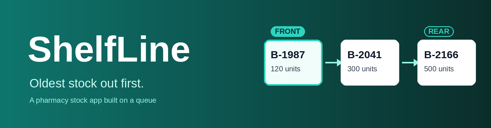
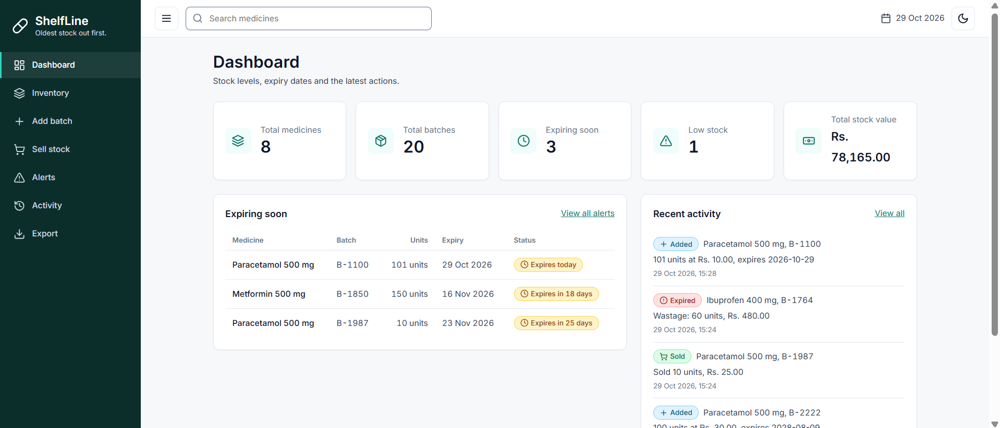
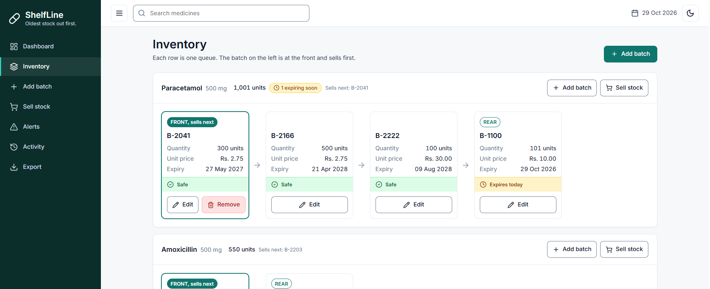
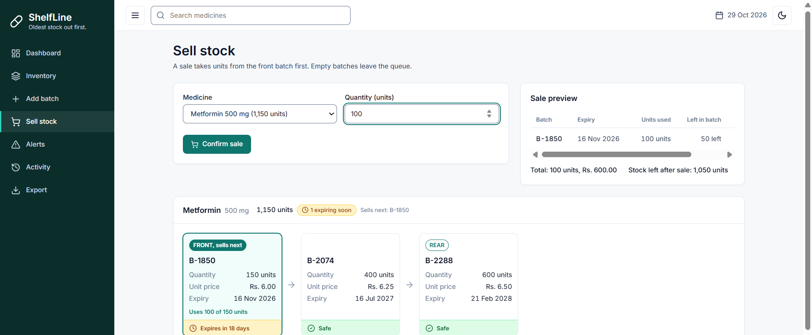
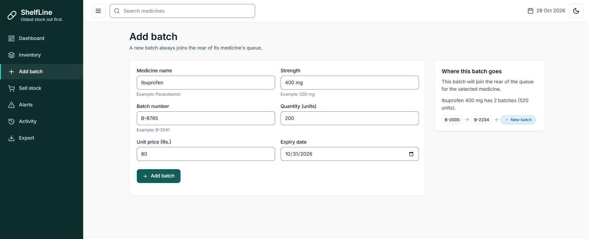
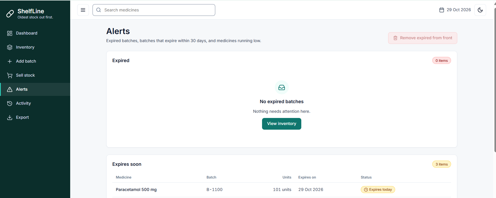
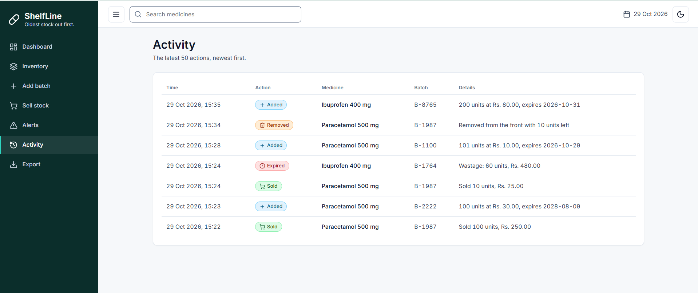
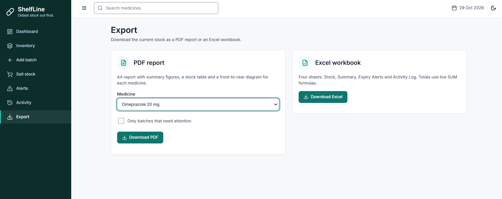
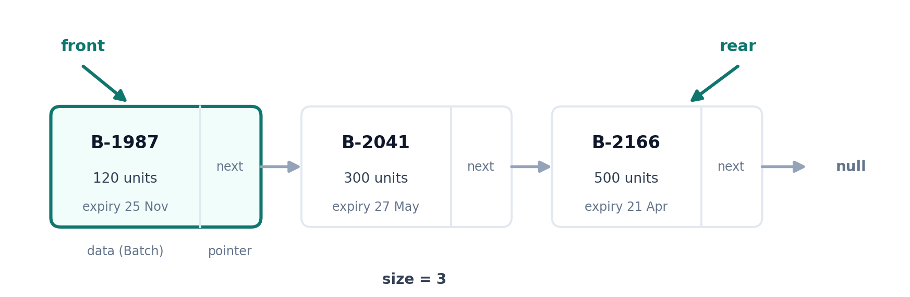
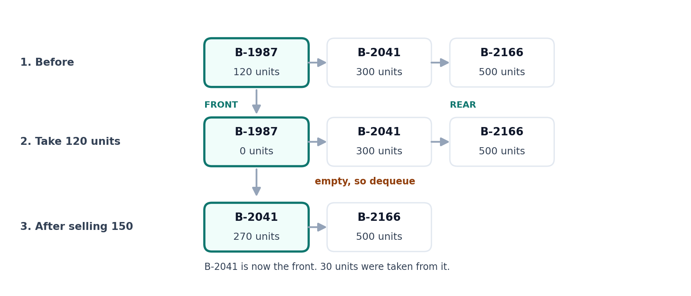

<p align="center">
  
</p>

<p align="center">
  
  
  
  
  
</p>

<p align="center">
  A small pharmacy stock app where every medicine is its own queue of batches,<br>
  and the oldest batch always gets sold first.
</p>

---

## Hi, this is ShelfLine

I built ShelfLine for my Data Structures and Algorithms lab (SW 212). My assigned data structure was the queue, so I went looking for a problem where a queue really is the right answer. Pharmacy stock turned out to be a good one.

Picture a shelf of paracetamol. Three deliveries came in over three months, and each has its own expiry date. If the newest box gets sold first, the oldest one quietly expires at the back and the shop loses the money it paid for it. The fix is as old as shops: sell the oldest stock first. In data structure terms, that is first in, first out.

So that is the whole idea. Each medicine gets its own queue. The oldest batch stands at the front and is sold first, and new deliveries join at the back. The app won't let a sale touch the middle or the back of a queue, so the rule can't be broken by accident.

I wrote the queue by hand with linked nodes. There is no `Queue`, `LinkedList` or `ArrayDeque` from Java anywhere in the project.

## A quick look

<table>
  <tr>
    <td width="50%"><br><sub><b>Dashboard.</b> Five numbers, what is about to expire, and the latest actions.</sub></td>
    <td width="50%"><br><sub><b>Inventory.</b> One lane per medicine. Front on the left, rear on the right.</sub></td>
  </tr>
  <tr>
    <td width="50%"><br><sub><b>Sell stock.</b> A live preview shows which batches a sale will use.</sub></td>
    <td width="50%"><br><sub><b>Add batch.</b> The side panel shows where the new batch will land.</sub></td>
  </tr>
  <tr>
    <td width="50%"><br><sub><b>Alerts.</b> Expired, expiring soon and low stock in one place.</sub></td>
    <td width="50%"><br><sub><b>Activity.</b> The last 50 things that happened, newest first.</sub></td>
  </tr>
  <tr>
    <td colspan="2" align="center"><br><sub><b>Export.</b> A PDF report or an Excel workbook.</sub></td>
  </tr>
</table>

## What it does

| Screen | What you can do there |
|---|---|
| Dashboard | See the number of medicines and batches, how many batches expire within 30 days, how many medicines are low, and the total value of the stock. |
| Inventory | Look at every queue as a row of batch cards. The front card says "FRONT, sells next" and the last one says "REAR". You can edit any batch and remove the front one. |
| Add batch | Add a delivery. It always joins the back of that medicine's queue. If the medicine is new, it gets a new queue. |
| Sell stock | Pick a medicine and a quantity. You see exactly which batches will be used before you confirm. Emptied batches leave the queue by themselves. |
| Alerts | Check expired batches, batches that expire soon and medicines that are running low. One button clears expired batches from the front and logs them as wastage. |
| Activity | Read the log of added, updated, sold, removed and expired batches. |
| Export | Download a styled PDF report or a styled Excel workbook. |

A few smaller things I took care over: you can search by medicine name, the layout works from a phone screen up to a wide monitor, there is a dark theme, and everything can be used from the keyboard.

## How the queue works

<p align="center">
  
</p>

The queue is two small classes. A `Node` holds one batch and points to the next node. The `Queue` remembers its `front`, its `rear` and its `size`.

```java
class Node  { Batch data; Node next; }
class Queue { Node front; Node rear; int size; /* eight methods */ }
```

Adding and removing only touch one end, so they never need a loop. Looking through the queue does, so those methods walk the nodes one by one.

| Method | Time | Why |
|---|---|---|
| `enqueue` | O(1) | only changes `rear` |
| `dequeue` | O(1) | only changes `front` |
| `peek` | O(1) | reads `front` |
| `isEmpty`, `size` | O(1) | read a counter |
| `toList` | O(n) | visits every node |
| `findByBatchNo` | O(n) | walks until it finds the batch |
| `update` | O(n) | finds the batch first, then edits it |

The four CRUD actions all go through the queue:

| CRUD | Queue method | In the app |
|---|---|---|
| Create | `enqueue` | Add batch |
| Read | `toList`, `peek` | Inventory lanes and "Sells next" |
| Update | `findByBatchNo`, `update` | Edit batch |
| Delete | `dequeue` | A batch sells out, expires, or is removed from the front |

One thing I like about this design is that a `Map` is only used to find the right queue by medicine name. All the batch data lives inside the linked nodes.

### What a sale looks like

Say Paracetamol has three batches and you sell 150 units. The front batch only has 120, so the sale takes all of it, removes that batch, and takes the last 30 from the next one.

<p align="center">
  
</p>

The sale loop always looks at the front with `peek`. The next batch only becomes reachable after `dequeue` removes the empty one, so the middle and the back can't be sold from.

## Batch status

Every batch has a status, and it always comes with an icon and a word, not just a colour.

<p align="center">
  
  
  
  
</p>

- **Safe** means more than 30 days left.
- **Expires soon** means 30 days or fewer, and that includes today.
- **Expired** means the date has passed. The app never sells an expired batch. If a sale reaches one, it stops and tells you how many units can still be sold.
- **Low stock** is for a medicine whose total is below 50 units. You can change that number in `application.properties`.

## Try it on your computer

You need JDK 17, Maven 3.9 or newer, and anything that can serve static files (Python is fine).

**1. Start the backend**

```bash
cd backend
mvn test
mvn spring-boot:run
```

The first run downloads packages, so give it a few minutes. When it is ready, the API is at `http://localhost:8080`. You can open `http://localhost:8080/api/summary` in a browser to check. It should show 8 medicines and 19 batches.

**2. Start the frontend** in a second terminal

```bash
cd frontend
python -m http.server 5500
```

**3. Open the app** at `http://localhost:5500`

The backend starts with sample data: 8 medicines and 19 batches, with one expired batch, two that expire soon, and one low-stock medicine. The dates are worked out from today, so the examples always make sense. Everything lives in memory, so restarting the backend puts the sample data back.

If you serve the frontend on a different port, tell the backend about it with the `ALLOWED_ORIGIN` environment variable. Separate several addresses with commas.

```bash
# Windows Command Prompt
set ALLOWED_ORIGIN=http://localhost:3000
mvn spring-boot:run
```

The frontend finds the backend through `frontend/js/config.js`.

## Under the hood

The backend is Spring Boot with a plain REST API. The frontend is HTML, CSS and JavaScript modules, with no framework and no build step.

| Method | Path | What it does |
|---|---|---|
| POST | `/api/batches` | Add a batch at the rear |
| GET | `/api/stock` | All queues, front to rear |
| GET | `/api/stock/{medicine}` | One queue |
| PUT | `/api/batches/{medicine}/{batchNo}` | Update quantity, price or expiry |
| POST | `/api/sell/preview` | Show which batches a sale would use, change nothing |
| POST | `/api/sell` | Make the sale |
| DELETE | `/api/batches/{medicine}/front` | Remove the front batch |
| POST | `/api/maintenance/remove-expired` | Remove expired front batches and log the wastage |
| GET | `/api/alerts` | Expired, expiring soon, low stock |
| GET | `/api/summary` | Dashboard numbers |
| GET | `/api/activity` | Latest 50 log entries |
| GET | `/api/export/pdf` | PDF report (optional `medicine` and `onlyAlerts`) |
| GET | `/api/export/excel` | Excel workbook |

`{medicine}` is the full name with its strength, for example `Paracetamol%20500%20mg`. Errors always come back in the same shape:

```json
{ "status": 400, "error": "Bad Request", "message": "Quantity must be 1 or more." }
```

The app checks the same rules in the browser and on the server:

- medicine name, strength and batch number can't be empty
- the batch number must be unique within its medicine (a repeat gives a 409)
- quantity is a whole number, 1 or more
- unit price is above 0
- the expiry date can't be in the past when you add a batch
- you can't sell more than what is in stock

The PDF has a header band, summary tiles, a stock table with status cells and a front-to-rear diagram for each medicine. The Excel file has four sheets (Stock, Summary, Expiry Alerts, Activity Log) with filters and real `SUM` formulas.

## Project layout

```
shelfline/
├── backend/
│   ├── pom.xml
│   ├── Dockerfile                   optional, only if you want to run it in Docker
│   └── src/
│       ├── main/java/com/shelfline/
│       │   ├── structure/           Node.java, Queue.java
│       │   ├── model/               Batch.java, MedicineStock.java
│       │   ├── service/             ShelfLineService.java, SeedData.java
│       │   ├── controller/          ShelfLineController.java
│       │   ├── export/              PDF and Excel export
│       │   ├── exception/           one error format for everything
│       │   ├── dto/                 request and response records
│       │   └── config/              CorsConfig.java
│       ├── main/resources/          application.properties
│       └── test/java/               QueueTest.java
├── frontend/
│   ├── index.html
│   ├── css/                         tokens.css, app.css, queue.css
│   ├── js/                          app, api, ui, validate, and one file per page
│   └── assets/
├── docs/                            report, screenshots, notes
└── README.md
```

## What it doesn't do

I kept it small on purpose, so the queue stays the star.

- There is no login and no database. Anyone who can reach the server can change stock, and a restart brings the sample data back.
- Batches are ordered by arrival, not by expiry date. Usually the older delivery expires first, and the status labels flag the cases where it doesn't.
- "Remove expired" only clears expired batches at the front, because a queue only gives you access to its front. An expired batch hiding behind a good one leaves when it reaches the front.

## What's in the docs folder

The project report (`ShelfLine_Project_Report.docx`) walks through every screen and button with numbered screenshots, explains each queue method, and lists the test cases. The `screenshots` and `images` folders hold the pictures used here, and the rest are the notes I wrote while preparing.

## About this project

| | |
|---|---|
| Course | SW 212 Data Structures and Algorithms, Open Ended Lab |
| University | Mehran University of Engineering and Technology, Shaheed Zulfiqar Ali Bhutto Campus, Khairpur Mir's |
| Roll number | K-25SW-040 |
| Data structure | Queue |
